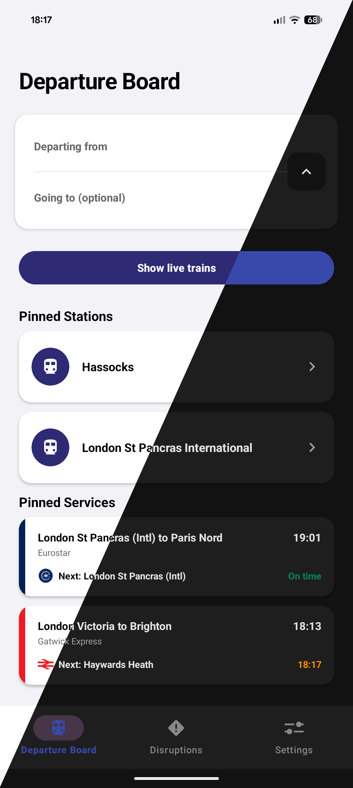
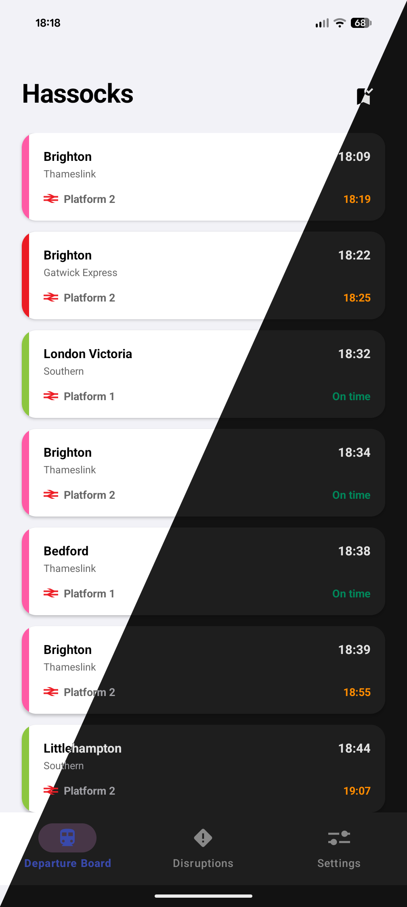
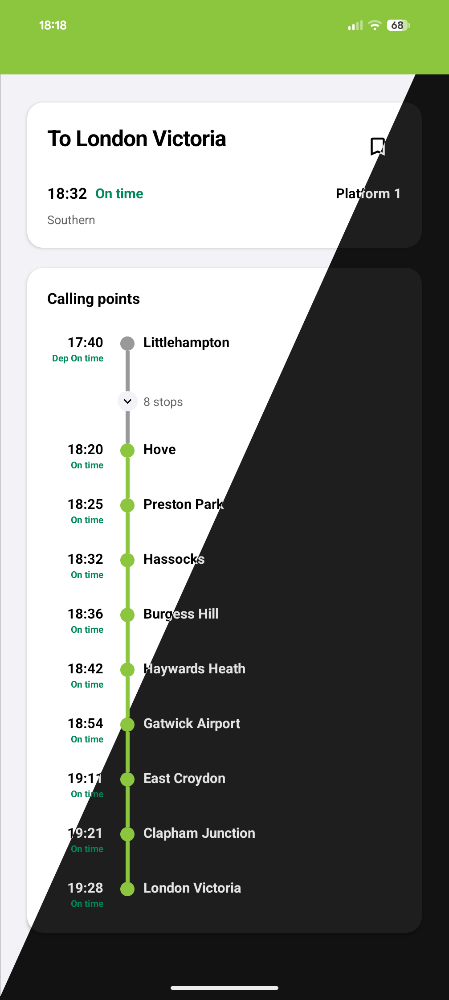
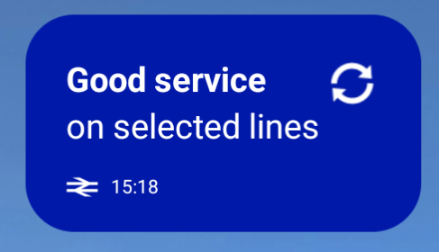
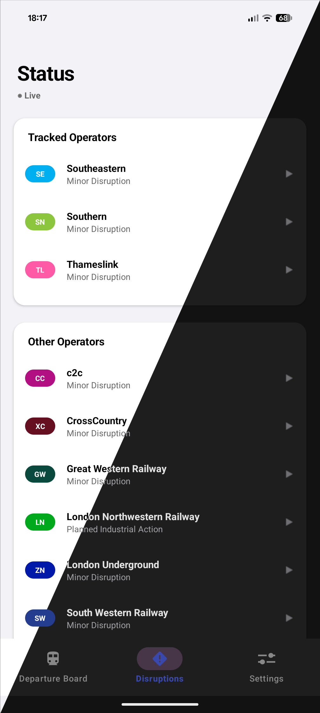
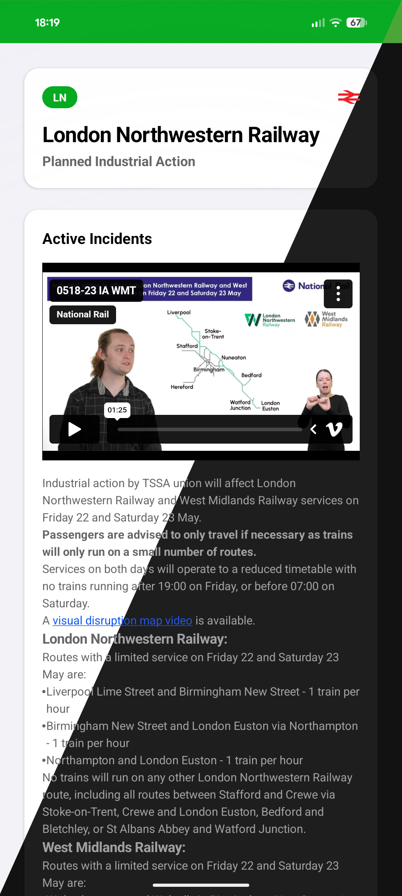
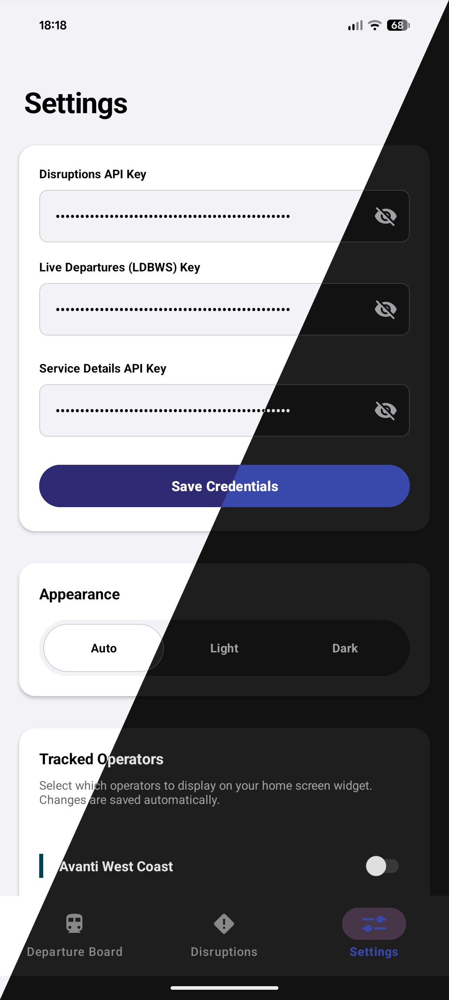

# Calling Point

Calling Point is a sleek, modern Android application and Home Screen Widget designed to keep you updated on real-time train disruptions across the UK National Rail network. Inspired by modern transit apps like TfL Go, it delivers clean, perfectly aligned disruption alerts right to your home screen.

## Screenshots

|                                              Departure Board                                              |                                             Station Services                                              |                                          Service Information                                          |                                                  Widget                                                   |
|:---------------------------------------------------------------------------------------------------------:|:---------------------------------------------------------------------------------------------------------:|:-----------------------------------------------------------------------------------------------------:|:---------------------------------------------------------------------------------------------------------:|
|  |  |  |  |
|                                            **Disruption Page**                                            |                                          **Detailed Disruption**                                          |                                             **Settings**                                              |                                                                                                           |
|     |  |                             |                                                                                                           |
## Features

* **Live Disruption Widget:** A beautifully aligned, customisable widget that sits on your home screen and updates seamlessly.
* **TOC Filtering:** Filter disruptions by your specific Train Operating Companies (e.g., Thameslink, Southeastern, Southern, London Overground).
* **Smart Caching & Syncing:** Minimises battery drain and API calls. The widget updates instantly when you modify filters or refresh the main app, avoiding background crash loops.
* **Detailed Incident Reports:** Tap the widget to open the app and read full, clickable HTML incident reports directly from National Rail.
* **Dynamic Branding:** UI elements dynamically tint to match the official brand colours of the affected train operators.

## Tech Stack

* **Language:** Java
* **Platform:** Android SDK
* **Networking:** Retrofit2 & Gson
* **Data Storage:** SharedPreferences (Local Caching)
* **API:** National Rail Disruptions Experience API

## Obtaining National Rail API Keys

To use this app, you need free API tokens from Rail Data:

1. Go to the [Rail Data Marketplace](https://raildata.org.uk).
2. Click **Register** and create a free account.
3. Once logged in, navigate to "Search the marketplace"
4. Search for [Service Details](https://raildata.org.uk/dashboard/dataProduct/P-4dec1247-d040-4290-80a4-639dfac54a92/overview), [Live Departure Board](https://raildata.org.uk/dashboard/dataProduct/P-d81d6eaf-8060-4467-a339-1c833e50cbbe/overview), and [NationalRail Disruptions API](https://raildata.org.uk/dashboard/dataProduct/P-fcf959e5-e454-4bef-a97d-83c749194f63/overview)
5. Once subscribed, you will be issued a **Customer Keys** (Token).
6. Copy these key's and paste it into the respective inputs under settings inside the Calling Point app.

## Setup & Installation

1. Download the APK from the latest release.
2. On the first launch, tap the settings icon to enter your **Customer Keys** and select your tracked TOCs.
3. Add the **Calling Point** widget to your Android home screen.

## Acknowledgements & Credits

> **Data:** Provided by [Rail Data](https://raildata.org.uk).
> 
> **Assets:** The app icon was generated using AI.