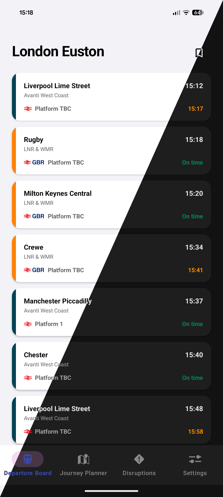
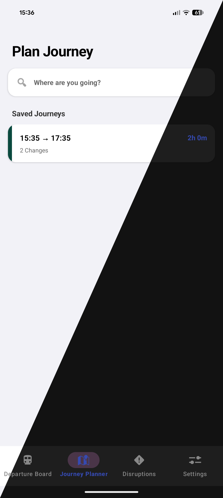
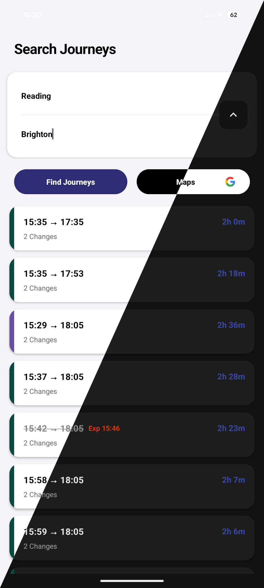
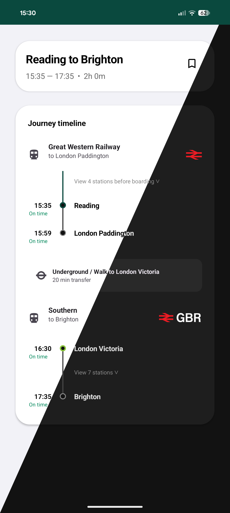
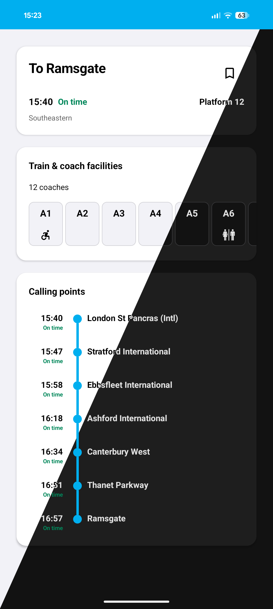
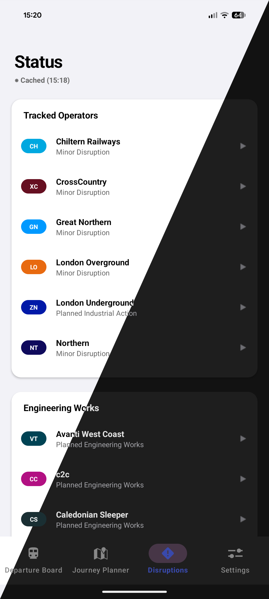
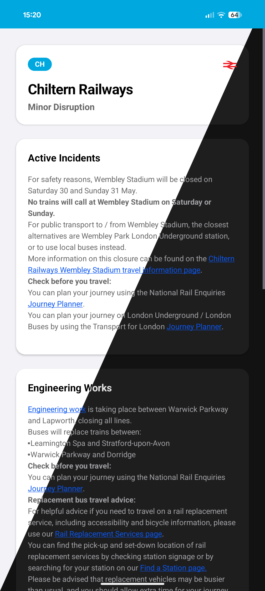

# CallingPoint

CallingPoint is a robust, feature-rich Android companion app designed for navigating the UK National Rail network. Built with a focus on real-time accuracy and intuitive design, it provides commuters and travelers with live departure boards, intelligent journey routing, and proactive disruption alerts.

---

## 🌟 Features

### 🚉 Live Departure Boards & Station Pins
Instantly check live departure times, platforms, and train operators for any station in the UK. To streamline your daily commute, you can pin your most frequented stations or specific live train services directly to the main dashboard for quick, one-tap access.

  
  

### 🗺️ Intelligent Journey Planner
Plan your travels effortlessly with a custom routing engine. The app finds direct trains, calculates multi-change routes, and even maps out cross-city transfers.
* Search and compare multiple journey options, viewing total durations and real-time delays at a glance.
* Save your most frequent routes to the "Saved Journeys" list for instant planning.
* Built in google maps implementation

  
  
  

### 🚆 In-Depth Service Details
Track your train's exact progress along its route. The service details view provides a visual timeline of all calling points, comparing scheduled times against live estimates. For supported services, you can check the train's coach formation (e.g., 12 coaches) and easily locate onboard facilities like accessible toilets before you board.

  

### ⚠️ Live Disruptions & Home Screen Widget
Never get caught off-guard by delays or cancellations. The Disruptions tab clearly categorizes network status into Tracked Operators, Other Operators, and Planned Engineering Works.
* Drill down into specific operators to read detailed active incident reports and replacement bus advice.
* Add the CallingPoint widget to your home screen for at-a-glance status updates (e.g., "Good service on selected lines") that automatically refresh in the background.

  
  

 

  

### ⚙️ Personalisation & Settings
Tailor the app to your preferences. Select between Auto, Light, and Dark themes for a comfortable viewing experience in any environment. You can securely configure your own National Rail API credentials and customise exactly which Train Operating Companies (TOCs) you want to actively track on your widget.

  

---

## 🛠️ Tech Stack & Architecture

* **Language:** Java
* **Architecture:** Fragment-based UI architecture.
* **Background Processing:** Utilises Android `WorkManager` for silent, periodic data synchronisation.
* **Networking:** Retrofit2 and Gson for parsing complex National Rail JSON APIs (LDBWS, Service Details, Disruptions).
* **Data Persistence:** `SharedPreferences` for pinning stations, offline journey caching, and secure user configurations.
* **Custom Routing Engine:** Incorporates an on-device graph-based routing engine combined with a custom cross-city transfer manager for precise multi-leg journeys.

---

## 🚀 Getting Started

### Download the App
The easiest way to use CallingPoint is to download the latest compiled APK directly from the **[GitHub Releases](https://github.com/Turtle358/CallingPoint/releases)** page.

### API Configuration
To fetch live data, CallingPoint requires active API keys from the National Rail Data Portal. Follow these steps to configure your app:

1. Go to the [Rail Data Marketplace](https://raildata.org.uk).
2. Click **Register** and create a free account.
3. Once logged in, navigate to **Search the marketplace**.
4. Search for and subscribe to the following data products:
    - [Service Details](https://raildata.org.uk/dashboard/dataProduct/P-4dec1247-d040-4290-80a4-639dfac54a92/overview)
    - [Live Departure Board](https://raildata.org.uk/dashboard/dataProduct/P-d81d6eaf-8060-4467-a339-1c833e50cbbe/overview)
    - [NationalRail Disruptions API](https://raildata.org.uk/dashboard/dataProduct/P-fcf959e5-e454-4bef-a97d-83c749194f63/overview)
5. Once subscribed, you will be issued **Customer Keys** (Tokens) for each service.
6. Open the Calling Point app, navigate to the **Settings** tab, and paste these keys into their respective input fields.

### Building from Source
If you prefer to build the app yourself:
1. Clone the repository to your local machine.
2. Open the project in Android Studio.
3. Build and deploy the app to your device or emulator.

---

## 📄 License

This project is licensed under the **Creative Commons Attribution-NonCommercial-NoDerivatives 4.0 International (CC BY-NC-ND 4.0)**.

You are free to:
* **Share** — copy and redistribute the material in any medium or format.

Under the following terms:
* **Attribution** — You must give appropriate credit, provide a link to the license, and indicate if changes were made. 
* **NonCommercial** — You may not use the material for commercial purposes.
* **NoDerivatives** — If you remix, transform, or build upon the material, you may not distribute the modified material.

See the `LICENSE` file for the full legal text.

## Acknowledgements & Credits

> **Data:** Provided by [Rail Data](https://raildata.org.uk).
>
> **Assets:** The app icon was generated using AI.
