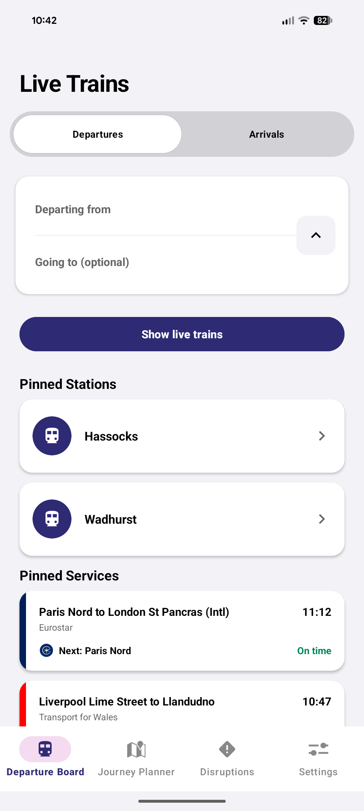
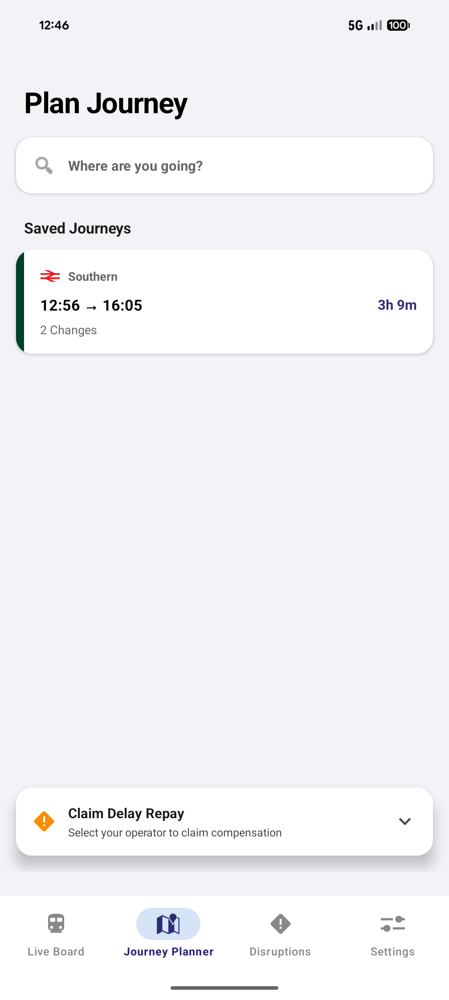
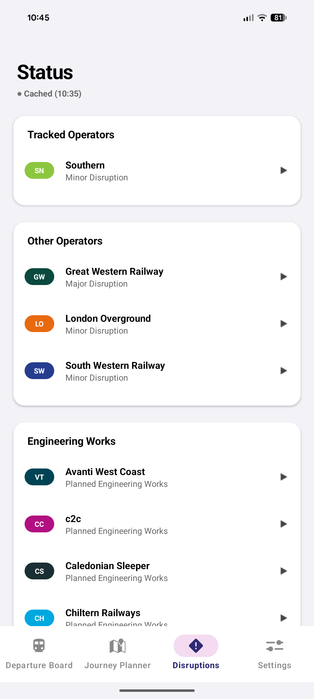
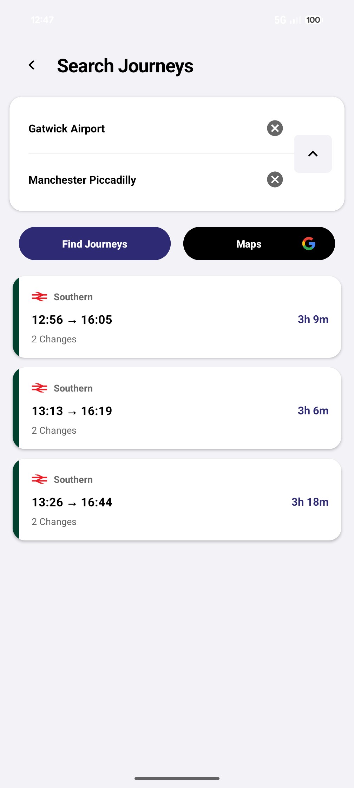
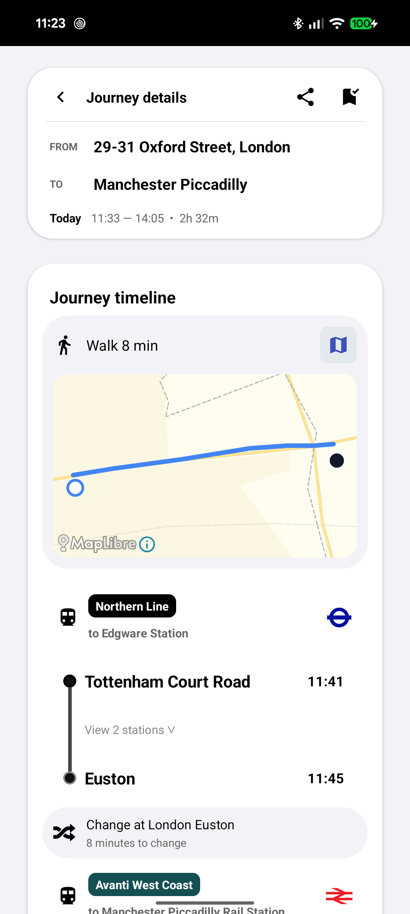
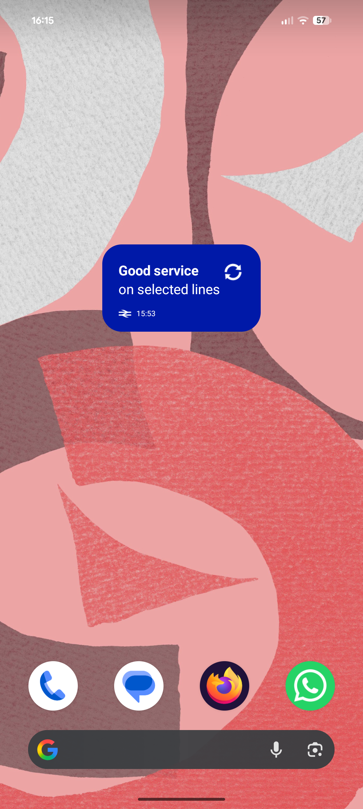

# CallingPoint

**Live UK train times, smarter journey planning, and disruption updates — all in one Android app.**

**[Website](https://callingpoint.co.uk/)** · **[Join Google Play testing](https://callingpoint.co.uk/)** · **[Report an issue](https://github.com/Turtle358/CallingPoint/issues)**

CallingPoint is a native Android companion for travelling on the UK National Rail network and London's public transport. Check live departures and arrivals, follow individual services, plan multi-leg journeys, and keep an eye on disruptions from your home screen.

Built to make everyday journeys easier, CallingPoint combines live transport information, a custom rail-routing engine, Transport for London (TfL) journey planning, and an interactive map. It is free, ad-free, and does not require an account or personal API keys.

## Preview

  <picture>
    <source media="(prefers-color-scheme: dark)" srcset="docs/readmeimg/LiveTrains-Dark.png">
    <source media="(prefers-color-scheme: light)" srcset="docs/readmeimg/LiveTrains-Light.png">
    
  </picture>
  <picture>
    <source media="(prefers-color-scheme: dark)" srcset="docs/readmeimg/JourneyPlannerHome-Dark.png">
    <source media="(prefers-color-scheme: light)" srcset="docs/readmeimg/JourneyPlannerHome-Light.png">
    
  </picture>
  <picture>
    <source media="(prefers-color-scheme: dark)" srcset="docs/readmeimg/Disruptions-Dark.png">
    <source media="(prefers-color-scheme: light)" srcset="docs/readmeimg/Disruptions-Light.png">
    
  </picture>

## Features

### Live departures, arrivals & train tracking

- View live station departure and arrival boards, including scheduled and expected times, platforms, operators, delays, and cancellations when available.
- Open a service to see its calling points and progress, with scheduled versus live timings.
- View train formations and onboard facilities for supported services.
- Pin frequently used stations or individual services to your dashboard and rearrange your pinned items.
- Receive change/delay notifications for pinned services, subject to Android notification permissions and background scheduling.

### Multi-modal journey planning

- Find direct and connecting rail journeys, including multi-change routes and cross-London transfers.
- Combine National Rail and TfL transport options, including Underground, Overground, Elizabeth line, DLR, buses, and trams where available.
- Search for journeys leaving at a chosen time or arriving by a chosen time.
- Choose fastest, fewest changes, or least walking, and select preferred transport modes.
- Apply a step-free preference when searching; always verify accessibility before travelling.
- Use your current location or saved Home and Work locations when planning a journey.
- Save regularly used routes and share individual journey itineraries through CallingPoint links.
- Explore walking connections on MapLibre vector maps, with light and dark map styles.

  <picture>
    <source media="(prefers-color-scheme: dark)" srcset="docs/readmeimg/JourneySearch-Dark.png">
    <source media="(prefers-color-scheme: light)" srcset="docs/readmeimg/JourneySearch-Light.png">
    
  </picture>
  <picture>
    <source media="(prefers-color-scheme: dark)" srcset="docs/readmeimg/JourneyPlan-Dark.png">
    <source media="(prefers-color-scheme: light)" srcset="docs/readmeimg/JourneyPlan-Light.png">
    
  </picture>

### Disruptions, engineering works & widget

- See disruption reports for tracked operators, other operators, and planned engineering works.
- Read incident details, affected services, and replacement transport guidance where provided.
- Choose which train operating companies to track.
- Add a home-screen widget for at-a-glance disruption information; Android schedules background refreshes.

  

### Personalisation

- Follow your device theme or select light/dark appearance.
- Choose between the default and pride app icons.
- Personalise your dashboard through pinned stations, services, and saved journeys.
- View transport-operator branding throughout the app.

## Install CallingPoint
### Join Google Play testing
CallingPoint is currently in alpha testing on google play, to become a tester for free, please fill in this [form](https://docs.google.com/forms/d/e/1FAIpQLSchOmnqODe6E8r1wa-mXT27pOYXIdxRnwbWoYAg0f7Uba3g5A/viewform?usp=sharing&ouid=104885425055942157899). Our testing programme requests your Google Play account email so that we can grant you access to the testing track.
## Technology & architecture

| Area | Implementation |
| --- | --- |
| Platform | Native Android |
| Language | Java |
| UI | Activities, Fragments, RecyclerView, Material components and Android themes |
| Transport APIs | National Rail data services and TfL integrations |
| Networking | Retrofit, OkHttp and Gson; CallingPoint API gateway for supported requests |
| Journey planning | On-device graph-based routing plus TfL journey-planning integration |
| Maps | MapLibre Native for Android, with light/dark vector styles and walking-route geometry |
| Background work | Android WorkManager for service tracking, widget updates and reference-data synchronisation |
| Local data | SharedPreferences and device-local saved journey/pinning data |
| Deep links | Shareable itinerary links that can open journey details in CallingPoint |

## Privacy & data

CallingPoint does not require a user account. Pinned stations, saved routes, and app preferences are stored on your device. Live boards, journey searches and maps use online data services; information such as search requests is transmitted to the relevant service to fulfil those requests.

For details, see the **[CallingPoint Privacy Policy](https://callingpoint.co.uk/privacy.html)**.

## Feedback & support

Found a problem or have an idea for an improvement? **[Open a GitHub issue](https://github.com/Turtle358/CallingPoint/issues)** or contact **[callingpoint@outlook.com](mailto:callingpoint@outlook.com)**.

## Licence

CallingPoint is distributed under the **[Creative Commons Attribution–NonCommercial–NoDerivatives 4.0 International](LICENSE)** licence (**CC BY-NC-ND 4.0**). You may share the material with attribution for non-commercial purposes, but you may not distribute modified versions under this licence. Consult `LICENSE` for the full terms.

## Acknowledgements

Transport and location information is supported by data and services from National Rail / Rail Data Marketplace, Transport for London (TfL), and mapping/routing providers including OpenStreetMap, OSRM, and MapLibre.

*CallingPoint is an independent app and is not an official National Rail or TfL product. Live data, platforms, accessibility information and journey options can change: check station announcements and operator advice before travelling.*

**[callingpoint.co.uk](https://callingpoint.co.uk/)**

